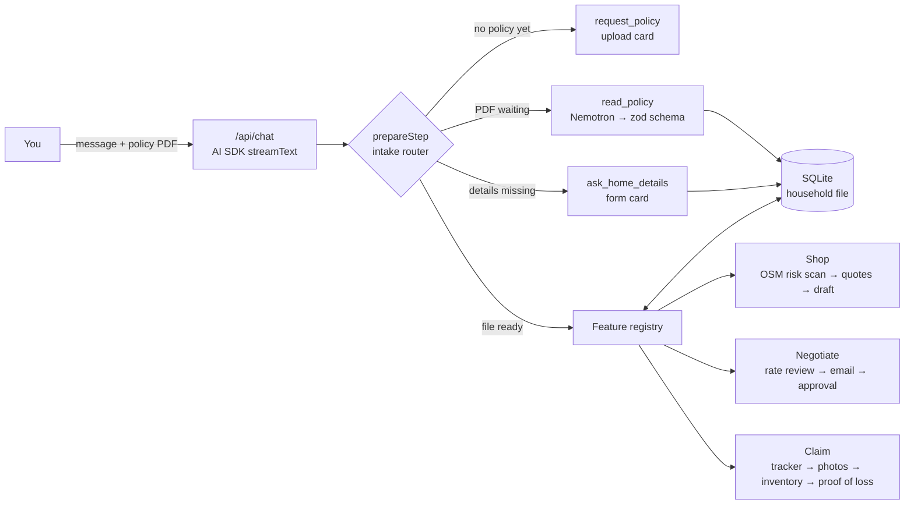

# hera

home insurance, but it's actually on your side for once

so basically insurance companies have ai everywhere now (88% of us auto insurers in an [naic survey](https://www.thewealthadvisor.com/article/naic-survey-88-insurers-are-using-ai-or-machine-learning) said they use it, plan to, or are looking into it) for pricing, fraud, claims, all of it. and you, the person literally paying them, get a 30 page pdf you've never opened. we thought that was kinda backwards so we built hera.

you give hera your policy once and it does the 3 things nobody wants to do:

1. **"i just got into a flood"** - it walks you through the whole claim
2. **"negotiate a lower rate"** - it finds the discounts you're missing and writes the email to your insurer
3. **"find me better insurance"** - it looks at where your house actually is and compares quotes

made in one day at cortex by redshifted in ottawa (theme: ai for humanity) by **pramsu, baran, annaji and wesley**


---

## why we care

ottawa flooded in 2017 and then AGAIN in 2019. and the thing is, most people only find out what their insurance covers after the basement is already full.

- 1 in 3 canadian homeowners think their regular policy covers floods when it doesn't ([ratesdotca / bnn bloomberg, 2022](https://insurancebusinessmag.com/ca/news/flood/one-in-three-canadians-think-their-home-insurance-policies-cover-water-damage-428755.aspx))
- flood coverage is available to like 94% of canadian homes now, and take-up went from 26% in 2017 to 71% in 2023 ([ibc, 2026](https://www.insurancebusinessmag.com/ca/news/catastrophe/94-of-canadian-homes-can-now-access-overland-flood-insurance-ibc-finds-583572.aspx)). so tons of people have it, they just don't know their limits or deductibles or deadlines
- the government promised a national flood insurance program for high-risk homes that can't get coverage. it was supposed to launch in april 2026 and it still isn't here ([insurance business, 2026](https://www.insurancebusinessmag.com/ca/news/catastrophe/prairie-storms-add-728-million-to-canadas-flood-bill-as-national-backstop-misses-launch-target-582735.aspx))
- and when you do file a claim it's at the worst moment of your life: 30 page policy, 90 days to get your proof of loss in, and you have to list every single thing you owned from memory. very cooked

---

## what it does

everything runs off one "household file" (your policy + your house) in a local sqlite db. hera asks for it once and then every feature uses it, so it never asks you the same thing twice.

For Vercel, `npm run build` creates a seeded SQLite file and includes it in the server bundle. Each function copies that seed to `/tmp` on first use, because Vercel's deployed filesystem is read-only; the copy supports chat reads and writes for the lifetime of that function instance.

### "i just got into a flood"

it opens a claim tracker that shows what's actually covered (for our demo policy that's overland water up to $50k with a $2,500 deductible) and the real deadline dates pulled from your policy. then you get a "before you clean up" checklist, because the adjuster needs to see the damage before you throw it out (most people have no idea).

it drafts your first notice of loss and waits for you to approve it. then you take pics of the room, a vision model figures out what got damaged, you add anything it missed, and it adds it all up against your contents limit. it also keeps track of hotel and food money for additional living expenses.

right before the sworn proof of loss it does an honesty check (how many items have photos vs. are from memory), because if anything on a proof of loss is false the whole claim can get voided.

### "negotiate a lower rate"

it looks at what you pay, how much it went up (our demo household went up 30% in 3 years), what discounts you already get, and which ones your file says you should be getting (alarm, leak sensors, sump pump, newer roof, no claims). it builds a case card with how much money is on the table, writes the email in a compose window, and does nothing until you hit approve.

### "find me better insurance"

it finds your house on openstreetmap and measures how far you are from the nearest fire hall, hydrant and river (this stuff actually changes your price irl), builds a risk profile, points out gaps in your current coverage, then fills out quote forms and compares them side by side.

---

## how it works



stuff we ran into today and how we fixed it:

- **the model kept skipping steps.** it would just ask for your policy in text instead of showing the upload card, or try to negotiate before reading the policy. so now the chat route uses the ai sdk's `prepareStep` as a little state machine. code decides which tool has to run next and forces it with `toolChoice`: load your file, read the pdf, ask for the policy if there isn't one, ask only for the details this job needs, then hand off to the feature. the model does the talking, the code does the order.
- **reading policies.** `unpdf` pulls the text out, then nemotron fills a strict zod schema (insurer, limits, deductibles, what's covered / limited / not covered, endorsements, exclusions, deadlines, discounts). junk values get filtered and everything gets validated before it goes in the db.
- **nim would sometimes just hang** on a policy read, so every model call has a timeout and a backup model (ultra, then lightning, then a "please upload it again" instead of spinning forever). vision does the same (nemotron vl, then llama 3.2 vision). policy reads are also cached by the pdf's sha-256, so the same file never gets read twice.
- **thinking mode made it way too slow**, so it's off for chat (`enable_thinking: false`). turn it back on with `HERA_THINKING=1`.
- **approvals.** anything that does something for you (sending an email, filing the claim) is a client tool. it shows up as an approval card and the agent literally pauses until you click.
- **features are plugins.** each one lives in `lib/hera/features/*` with its own tools, instructions and "what's next" logic, and the ui renders each result as its own card. adding a 4th feature is just adding a folder.
- **chats** are saved in sqlite and each turn takes a lock, so two agents can't fight over the same file (the second request gets a 409).

### which model does what

| job | model (nvidia nim) |
| --- | --- |
| the agent: talking, tool calls, routing | `nvidia/nemotron-3-ultra-550b-a55b` |
| backup agent + fast policy reading | `nvidia/nemotron-3.5-lightning-30b-a3b` |
| policy pdf → structured coverage | nemotron ultra, lightning as backup |
| flood photos → list of damaged stuff | `nvidia/nemotron-3.5-super-vl-120b-a12b`, `meta/llama-3.2-90b-vision-instruct` as backup |

you can switch providers with one env var (anthropic and vercel ai gateway work too, see `env.local.example`)

### keeping tokens down

- each policy gets read once and then it's cached, so re-running the demo costs 0 tokens
- code picks the next tool, so the model doesn't waste turns figuring out what to do (max 8 steps per turn)
- big stuff like claim photos and quote tables only goes to the model as names, the ui reads the full thing from the db
- thinking is off
- the form only asks for what's missing for the job you picked

---

## security (the stuff we actually do)

- api keys stay on the server in `.env.local` (gitignored), the browser never sees them
- your household file is a local sqlite file, also gitignored
- date of birth is marked sensitive and only asked for when you shop for quotes
- nothing gets sent or filed without you clicking approve

## what's real and what's fake

we'd rather just tell you lol

| real | fake (and labelled in the app) |
| --- | --- |
| reading your policy pdf into structured coverage | **birchwood mutual** and every other insurer in the app are made up |
| claim deadlines + limits pulled from your policy | the "hera is browsing" desktop is a scripted replay |
| the vision inventory from your photos | quotes are samples (there's no public quote api) |
| openstreetmap + fire hall / hydrant / water distances | sending emails and filing claims: **nothing actually gets sent** |
| your file, chats and claims saved in sqlite | the insurer's reply to the negotiation email |

---

## where we'd take it next

we looked into what it would take to make this actually real:

1. **real flood maps.** ontario conservation authorities publish their regulated floodplain maps as open data ([conservation ontario open data hub](https://library.mcmaster.ca/maps/geospatial/conservation-ontario-co-open-data-hub)) and nrcan keeps a canada-wide [flood map inventory](https://geo.ca/flood-mapping/flood-map-gallery/canada-flood-map-inventory/). checking your address against those would turn our estimate into "your house is in the 1-in-100-year floodplain"
2. **warn you before the flood.** watch environment canada alerts and river forecasts, and when your area's at risk, text you: move stuff upstairs, take "before" photos now, here's what you're covered for. the claim basically starts before the water does
3. **inventory before anything happens.** do a 2 minute video walk through your house now and hera builds your contents list, so after a flood it's a before/after comparison instead of trying to remember every fork you owned
4. **doing the computer stuff for real.** a real browser agent filling real quote forms, and pulling your policy + renewal notice straight from your email (still with approval before anything gets submitted)
5. **calling your insurer for you.** a voice agent that waits on hold, asks for the discounts, and reports back
6. **scanned policies.** lots of policies are scans or phone pics, so read the page images with the vision model instead of just pdf text
7. **the national flood program.** when it finally launches, check if you qualify and walk you through signing up
8. **text it.** sms / whatsapp, because nobody's opening a web app while their basement floods
9. **prod stuff.** encrypt personal info at rest (aes-256-gcm, keys in a kms), strip personal info before it goes to a model, guard against prompt injection in uploaded pdfs (a pdf is untrusted input), an eval set of real policies to measure how accurate extraction is, and an audit log of everything you approved

---

## run it

needs **node 22.13+** (for the built-in `node:sqlite`)

```bash
npm install
cp env.local.example .env.local   # add NVIDIA_API_KEY (or another provider)
npm run dev                       # http://localhost:3000
```

then in another terminal, load the demo household (maya patel, fake insurer birchwood mutual):

```bash
npm run seed            # home details + premium history, upload the policy yourself in the chat
npm run seed -- --full  # also loads the policy, so all 3 features are ready right away
npm run db:seed         # create the deployment seed database without starting the app
```

refresh the page, type *"i just got into a flood"* and drop in `public/demo/birchwood-policy.pdf` when hera asks.

tests: `node --test tests/`

### where stuff lives

```
app/api/chat          chat route: intake router, tools, streaming
app/api/profile       household file (GET / POST patch / DELETE reset)
app/api/chats         saved conversations
app/api/dev/seed      demo seed (npm run seed)
lib/hera/             db, policy + profile schemas, extraction, model config, seed
lib/hera/features/    shop · negotiate · claim (tools + routing per feature)
components/hera/      chat ui, cards, agent desktop, approval cards
```

toodles :3
