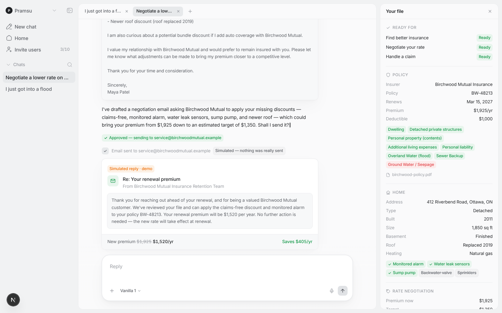
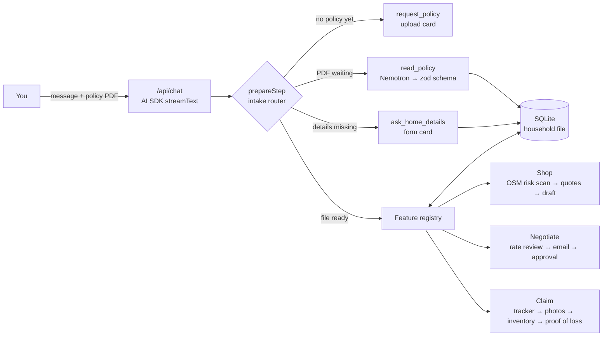

# hera

your home insurance, except it actually works for you

okay so basically: insurance companies have a whole army of ai doing underwriting, fraud scoring, claim triage, all of it. you, the person literally paying them, get a 30 page pdf you've never read. hera fixes ts.

you give hera your policy pdf once and it does the three things nobody wants to do:

1. **"i just got into a flood"**: walks you through the whole claim, step by step
2. **"negotiate a lower rate"**: finds the discounts you're missing and writes the email to your insurer
3. **"find me better insurance"**: checks your home's actual risk and compares quotes

built in one day at **cortex by redshifted** (ottawa) for "ai for humanity"

team: pj, ___, ___, ___



---

## why this matters (not just vibes)

- **1 in 3 canadian homeowners think their normal policy covers floods when it doesn't** ([ratesdotca / bnn bloomberg, 2022](https://insurancebusinessmag.com/ca/news/flood/one-in-three-canadians-think-their-home-insurance-policies-cover-water-damage-428755.aspx))
- flood coverage is available to ~94% of canadian homes now, and take-up went from 26% in 2017 to 71% in 2023 ([ibc, 2026](https://www.insurancebusinessmag.com/ca/news/catastrophe/94-of-canadian-homes-can-now-access-overland-flood-insurance-ibc-finds-583572.aspx)). so more people HAVE it than ever, they just don't know their limits, deductibles or deadlines until the basement is already full
- ottawa flooded in 2017 AND 2019. a claim hits you at literally your worst moment: 30 page policy, 90 day proof-of-loss deadline, and you have to list everything you owned from memory. very cooked
- renewals go up every year and most people never ask for the discounts they already qualify for

hera reads the fine print, does the paperwork, and asks before it does anything for you.

---

## what it does

everything runs off **one household file** (your policy + your home) saved in a local sqlite db. hera collects it once and every feature reuses it, so it never asks you the same thing twice.

### 1. "i just got into a flood"

- opens a claim tracker with your policy’s relevant coverage, limits, deductible and deadline dates, plus a “before you clean up” checklist
- prepares the first notice of loss and waits for approval
- **camera-roll inventory**: choose photos from before or after the loss, even everyday photos with belongings in the background. hera identifies visible items and suggests replacement estimates in CAD
- review each belonging, edit its details or value, confirm it was lost or damaged, and remove duplicates. add anything the photos missed without preset claim amounts
- **receipt reading**: attach a receipt image to a belonging. hera extracts its purchase amount, merchant and date, keeping the original purchase price separate from today’s replacement estimate
- explains policy limits and settlement terms, then offers an optional hotel + extra living-expenses step
- shows a final claim review and waits for approval of the proof of loss. unconfirmed belongings cannot be submitted

submissions are simulated and saved locally; the presentation UI has no demo labels. failed photo analysis never inserts fabricated belongings. [full walkthrough, research sources and presentation notes](docs/claim-flow.md).

### 2. negotiate a lower rate

- looks at your premium, renewal history, the discounts you already get, and the ones your file says you SHOULD get (monitored alarm, leak sensors, sump pump, claims-free years...)
- builds a case card with the $$ at stake
- types the email into a compose window and waits for you to hit approve

### 3. find me better insurance

- geocodes your address with openstreetmap and measures the distance to the nearest fire hall, hydrant and river/lake (these literally change your price irl)
- builds a risk profile and finds gaps in your current coverage
- fills out each insurer's quote form with your file, compares them side by side, and drafts a quote request for the one you pick

---

## how it works



the stuff we're actually proud of:

**the intake can't be skipped.** agents LOVE skipping steps or just asking for stuff in plain text. so instead of praying the prompt works, the chat route uses the ai sdk's `prepareStep` as a little state machine over the household file. code decides which tool HAS to run next and forces it with `toolChoice`:

1. load the file
2. read the pdf
3. ask for the policy if there isn't one
4. ask only for the details this job still needs
5. hand off to that feature's own `nextStep`

the model does the talking, the code does the routing.

**policy reading.** `unpdf` pulls the text, then nemotron fills a strict zod schema: insurer, limits, deductibles, coverages (covered / limited / not covered), endorsements, exclusions, deadlines, discounts. junk values get filtered and everything is validated before it touches the db. results are cached by the pdf's sha-256, so the same policy never gets read twice.

**fallback chains everywhere.** every model call has a first-chunk timeout and a backup. policy reading goes nemotron ultra → nemotron lightning → a clean "upload it again" error instead of hanging forever. vision goes nemotron 3.5 super vl → llama 3.2 90b vision.

**feature plugins.** each feature (`lib/hera/features/*`) is its own module: tools, approval tools, instructions and a `nextStep` router. the chat route merges them, and the ui renders each tool result as its own card (`components/hera/features/*`). adding a 4th job = adding one folder.

**human in the loop.** anything that speaks for you is a client tool (`confirm_*`). it shows up as an approval card, the agent pauses, and it only picks back up when you click (`addToolOutput` + `sendAutomaticallyWhen`).

**chats that don't double-fire.** conversations are saved in sqlite and each turn takes a lock. a second request for the same chat while one is running gets a 409, so you never get two agents fighting over the same file.

**context diet.** big feature data (claim photos, quote tables, drafts) only goes to the model as keys. the ui reads the full thing straight from the db.

### which model does what

| job | model (nvidia nim) |
| --- | --- |
| the agent: conversation, tool calls, routing | `nvidia/nemotron-3-ultra-550b-a55b` |
| backup agent + fast policy reading | `nvidia/nemotron-3.5-lightning-30b-a3b` |
| policy pdf → structured coverage (schema-constrained) | nemotron ultra, lightning as backup |
| flood photos → itemized contents inventory | `nvidia/nemotron-3.5-super-vl-120b-a12b`, `meta/llama-3.2-90b-vision-instruct` as backup |

you can swap providers with one env var (anthropic and vercel ai gateway work too, see `env.local.example`)

### token efficiency

- **each policy gets read once.** the sha-256 cache means re-uploading or re-running the demo costs 0 tokens
- **code picks the next tool**, so the model doesn't burn turns figuring out what to do. capped at 8 steps per turn
- **lean context.** the model only sees the keys of bulky feature data
- **thinking is off for chat turns** (`enable_thinking: false` on nemotron). flip it back on with `HERA_THINKING=1`
- **only asks what's missing.** the details form only shows the sections this job still needs

---

## security stuff (that we actually do)

- api keys only live server-side in `.env.local` (gitignored). every model call happens in an api route, so the browser never sees a key
- your household file is a local sqlite file (`data/hera.db`), also gitignored
- date of birth is flagged sensitive and only asked for when a job needs it (just shopping)
- nothing gets sent or filed without you clicking approve. ever.

## what's real vs. fake

we'd rather tell you than have you find out lol

| real | simulated (labelled in the ui) |
| --- | --- |
| reading your policy pdf into structured coverage | **birchwood mutual** and every insurer shown are made up |
| claim deadlines + limits pulled from your policy | insurer portals: the "hera is browsing" desktop is a scripted replay |
| vision inventory from your photos | quotes are samples (there's no public quote api) |
| openstreetmap geocoding + fire hall / hydrant / water distances | sending emails and filing claims: **nothing ever gets sent** |
| household file, chats and claims saved in sqlite | the insurer's reply to the negotiation email |

## if we shipped this for real (not built yet)

honest list of what prod would need:

- field-level encryption for pii at rest (aes-256-gcm, keys in a kms). right now it's a local file
- redacting pii before anything goes to a model
- a prompt-injection guard on uploaded pdfs, because a policy pdf is untrusted input
- an eval set of real policies to measure extraction accuracy
- real broker/insurer apis instead of the scripted browser, plus pulling your policy straight out of gmail
- an audit log of every action you approved

---

## run it

needs **node 22.13+** (for the built-in `node:sqlite`)

```bash
npm install
cp env.local.example .env.local   # add NVIDIA_API_KEY (or another provider)
npm run dev                       # http://localhost:3000
```

try it with the demo policy at `public/demo/birchwood-policy.pdf` (fake insurer). type *"i just got into a flood"* and drop the pdf in when hera asks.

tests: `node --test tests/`

### where stuff lives

```
app/api/chat          chat route: intake router, tools, streaming
app/api/profile       household file (GET / POST patch / DELETE reset)
app/api/chats         saved conversations
lib/hera/             db, policy + profile schemas, extraction, model config
lib/hera/features/    shop · negotiate · claim (tools + routing per feature)
components/hera/      chat ui, cards, agent desktop, approval cards
```

toodles :3
